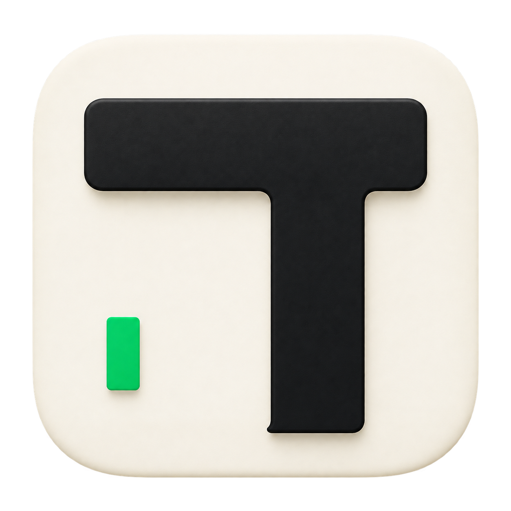
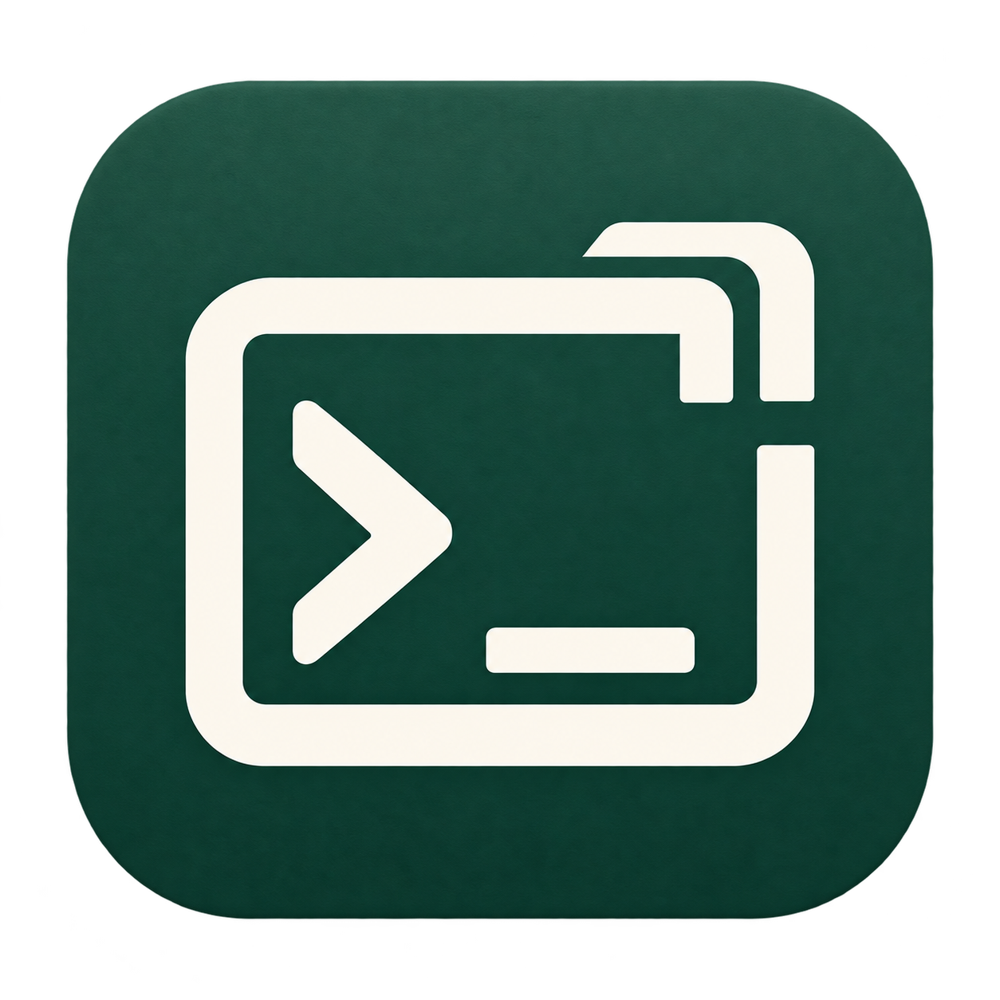
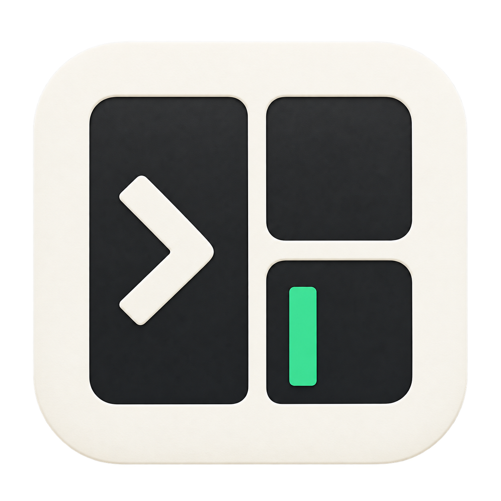
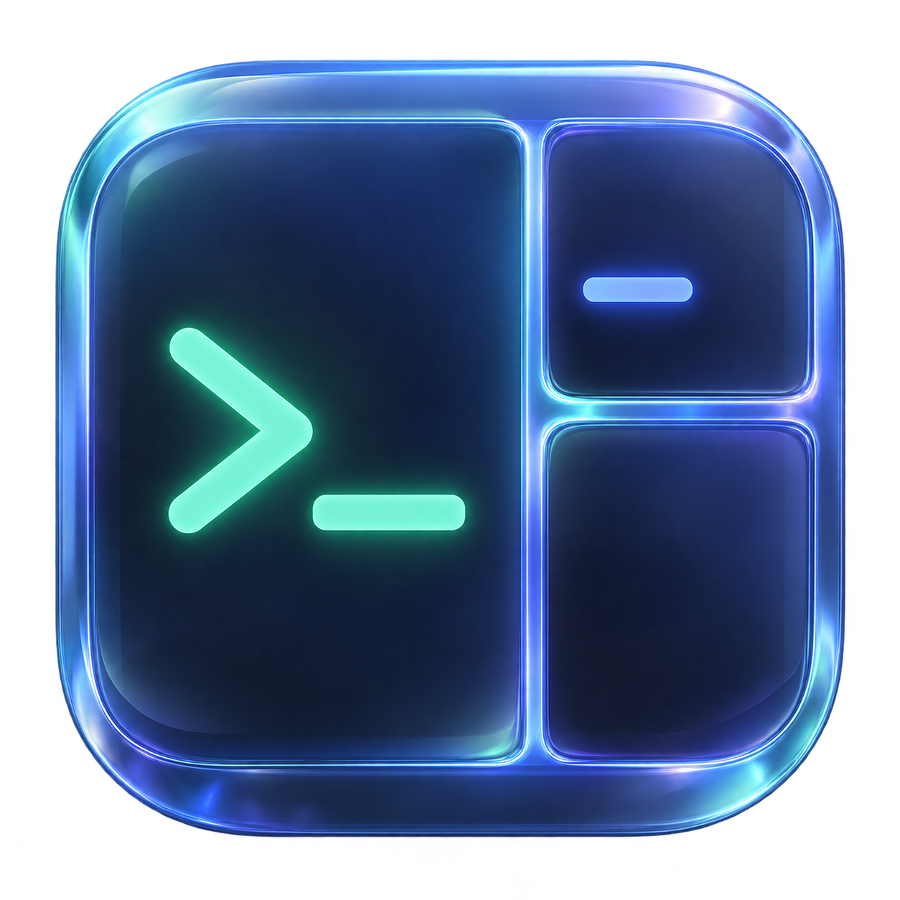
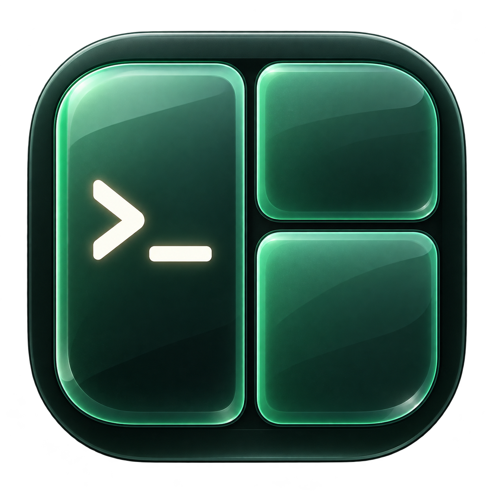
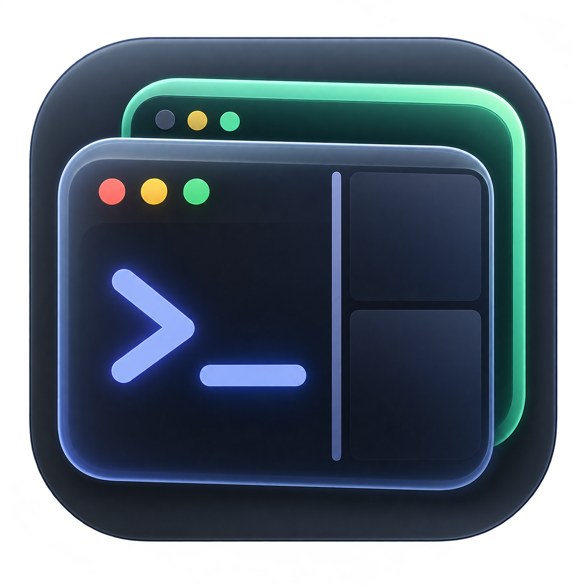
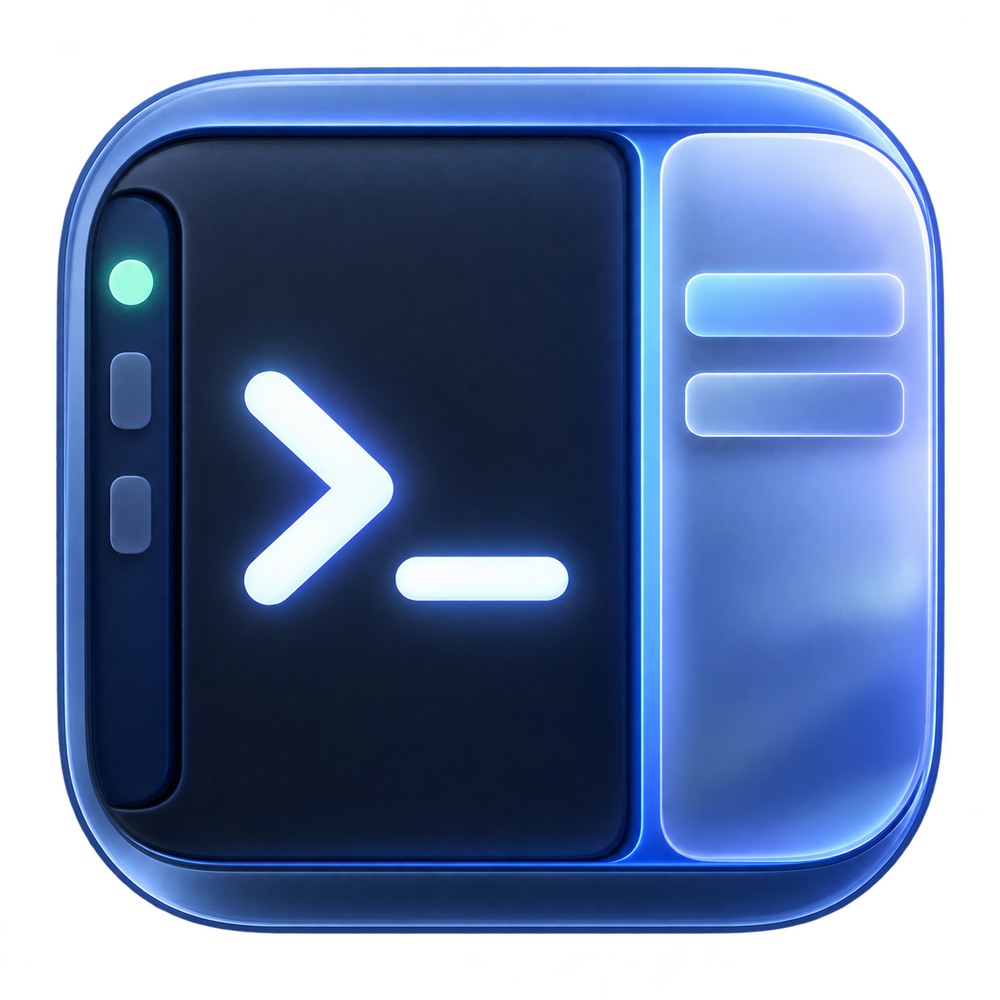
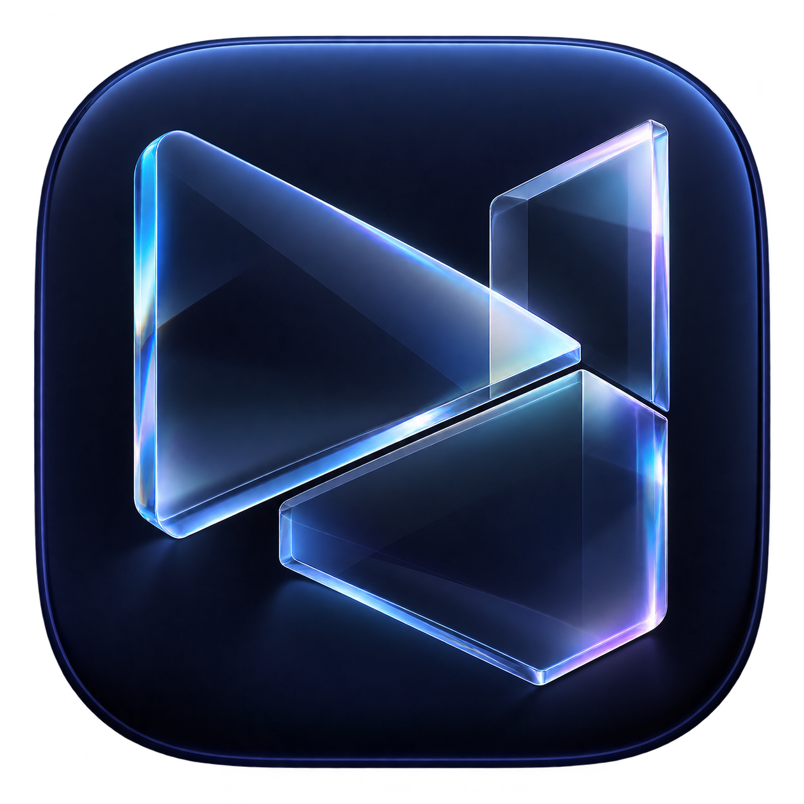
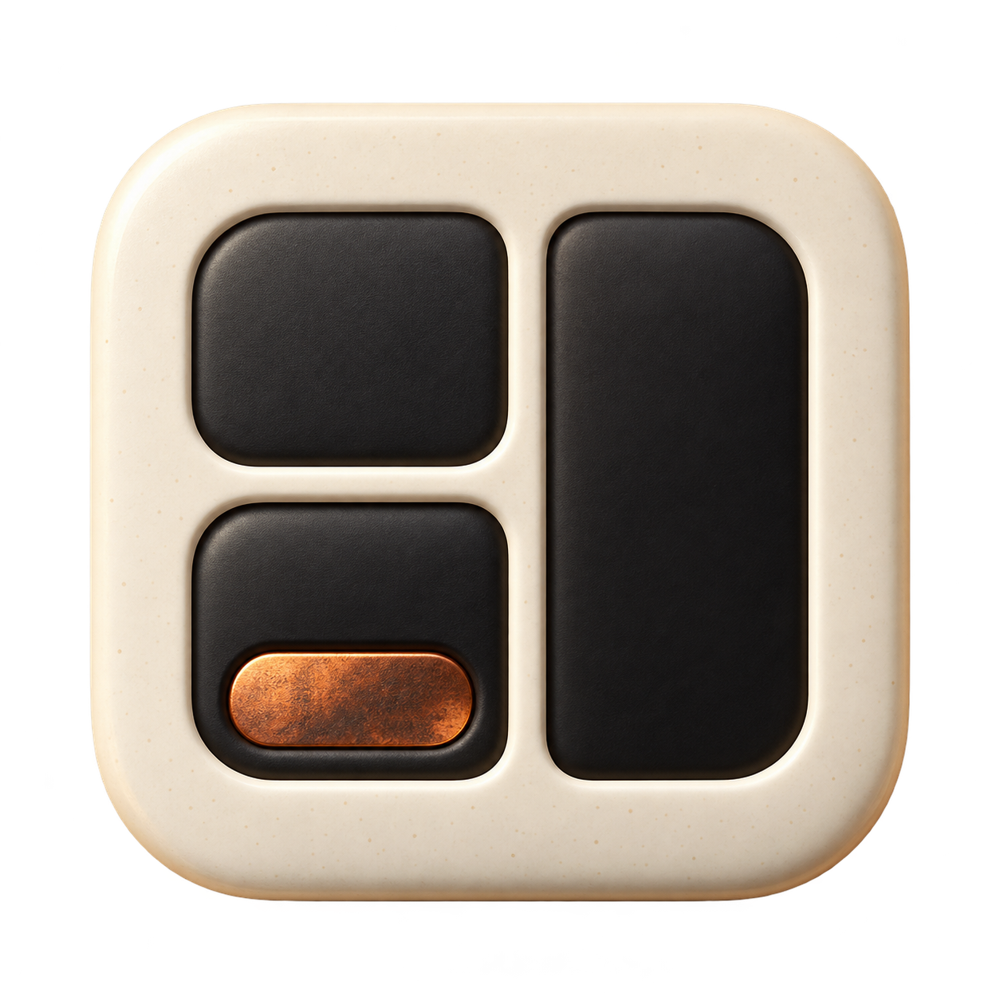

# Tmux Panel 应用图标方案集

优先比较最新的 **I–N**。每版提供大图、48px 缩小预览和设计含义；点击大图可查看原始图片。

所有图片均由内置生图生成，已随文档保存在仓库中，使用相对路径引用。下文描述的是设计意图；缩小预览用于比较轮廓和对比，macOS 实际呈现还受系统圆角、留白和材质处理影响。

**当前状态：F「tmux 绿」已用于应用包与网页（提交 `b73108a`）；以下同时保留原方案供比较，新的替代方案尚在选择中。**

## 最新方案 · I–N

| **I · 会话扣** | **J · 熔橙命令** | **K · 切面 T** |
| :---: | :---: | :---: |
|  |  |  |
|  |  |  |

| **L · 蓝紫分岔** | **M · 终端印章** | **N · 黑白工作区** |
| :---: | :---: | :---: |
|  |  |  |
|  |  |  |

| 方案 | 设计含义 |
| --- | --- |
| **I · 会话扣** | 用白色与玉绿的直角括号相互扣合，表达 tmux 会话的连接、脱离与持续运行。 |
| **J · 熔橙命令** | 将终端提示符连接成一笔折返的黑色符号，以橙色背景突出命令输入这一核心操作。 |
| **K · 切面 T** | 以非对称的黑色 T 指向 Terminal 与 Tmux，并用绿色光标标记正在等待输入的终端状态。 |
| **L · 蓝紫分岔** | 通过一根主干分出两条开放支路，表达同一工作入口下并行展开的会话与任务。 |
| **M · 终端印章** | 以终端框和 >_ 明确项目用途，右上角的叠框缺口引入多个终端会话的意象。 |
| **N · 黑白工作区** | 以左侧主面板和右侧上下两格表现终端主区、分屏及辅助内容的组合，绿色光标标记当前活动位置。 |

## 终端与工作台方向 · E–H

| **E · 棱镜分屏** | **F · tmux 绿** | **G · 持久会话** | **H · 一体工作台** |
| :---: | :---: | :---: | :---: |
|  |  |  |  |
|  |  |  |  |

| 方案 | 设计含义 |
| --- | --- |
| **E · 棱镜分屏** | 把终端提示符与非对称三分屏直接组合，以蓝紫玻璃边缘呼应原生客户端的透明和毛玻璃效果。 |
| **F · tmux 绿** | 以玉绿色三分屏和暖白提示符表达 tmux 的终端复用。左侧主终端与右侧两个辅助面板形成明确分工；这是当前已采用的方向。 |
| **G · 持久会话** | 用前后叠放的终端卡片表现多个会话共存，后方仍可见的绿色窗口象征切换界面后会话继续存在。 |
| **H · 一体工作台** | 将会话侧栏、主终端和文件预览合成一个工作台符号，强调项目在终端之外还提供导航与文件查看能力。 |

## 早期材质与结构方向 · A–D

| **A · 棱镜玻璃** | **B · 黑钛终端** | **C · 折叠工作区** | **D · 暖白建筑** |
| :---: | :---: | :---: | :---: |
|  |  |  |  |
|  |  |  |  |

| 方案 | 设计含义 |
| --- | --- |
| **A · 棱镜玻璃** | 以相交的玻璃切面表现工作区之间的分割与连接，呼应客户端的透明材质。重点是光学折射和空间层次。 |
| **B · 黑钛终端** | 将终端提示符提炼成金属箭头与橙色光标，表达命令输入和工具的精确性。深色底与局部暖色构成视觉重心。 |
| **C · 折叠工作区** | 用连续折叠的带状结构组成两个交错工作区，表达多窗口之间的联系和切换。蓝色底与浅色折带强调层次。 |
| **D · 暖白建筑** | 以左侧上下两格和右侧长面板表现分屏，暖白框体与铜色光标形成建筑构件般的组合。探索更温暖的工具形象。 |
