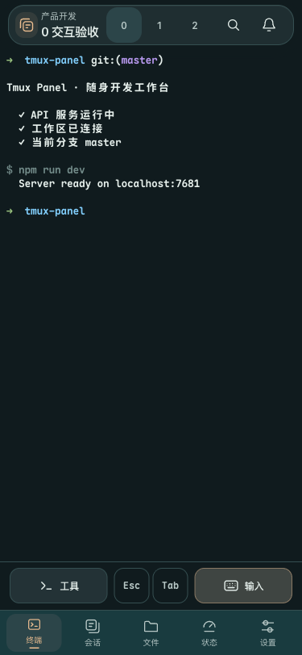
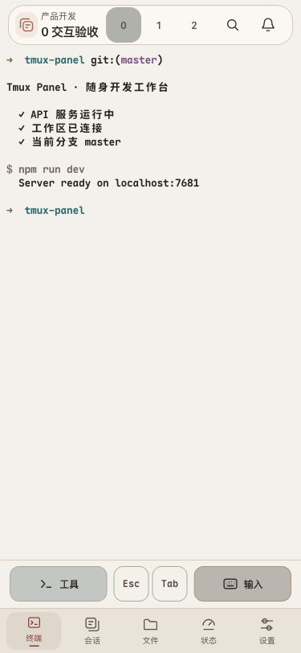
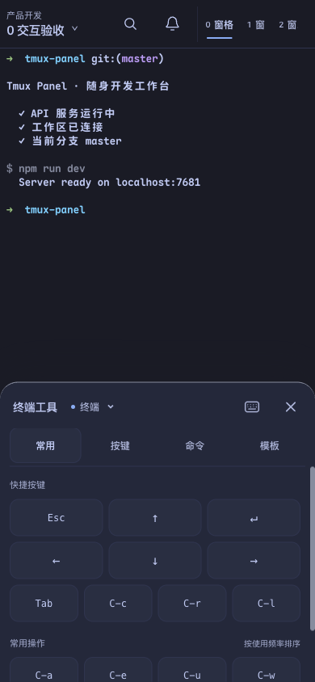
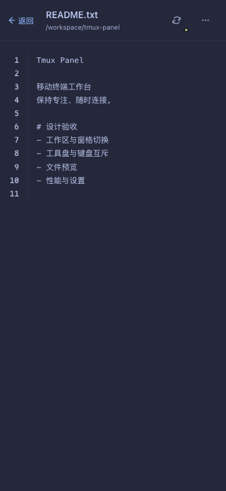
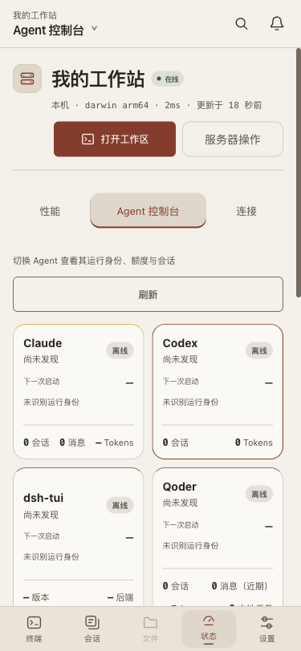

# 移动工作台

移动端以终端为主画布，顶部只保留当前上下文、搜索、通知和窗格切换，底部提供终端、会话、文件、状态、设置五个直接入口。颜色跟随同一个主题注册表，不单独维护手机调色方案。

2026-10-23 顶栏细化：内收圆角浮层、窗口叠层入口与数字窗格按钮替换字符下箭头和拥挤的小标签，搜索/通知保持 44px 触点。竖屏顶栏含外侧间距占 62px，比前版增加 2px。

| 最新顶栏 · 深色 | 最新顶栏 · 浅色 |
| --- | --- |
|  |  |

- **终端输入**：工具、Esc、Tab、输入固定在终端下方的正常布局中，不遮住终端单元格。工具盘展开时覆盖底部导航并重新分配终端高度；快捷键发送后保持展开。键盘输入始终在点击回调中同步聚焦，软键盘与工具盘互斥。
- **会话与窗口**：从底部打开会话面板，保留会话折叠、新建、窗口切换及每行操作。背景不可交互，Tab 焦点约束在面板内；关闭后回到实际触发按钮。
- **文件**：本机终端直接浏览当前窗格目录。手机全屏阅读，返回按钮依次回到目录和工作区，更多操作使用底部操作单。远端终端不会误展示本机文件。桌面预览 Tab 仍保留，最大分栏宽度仍为共享工作区的 70%。
- **状态**：机器资源、趋势和窗口明细改为纵向阅读，Agent 数据源用紧凑双列，账号与用量详情单列。检测与独立展示收在服务器操作中，性能、Agent、连接仍直接切换。
- **设置**：页面内部提供外观、管理中心、连接与安全、GitHub 分类入口，避免依赖隐藏的桌面侧栏。

手机以 `<768px` 为基础，同时覆盖 `pointer:coarse`、高度不超过 560px、宽度不超过 1023px 的横屏。横屏将全局导航移到顶部右侧，给终端留出高度；输入软键盘时隐藏全局导航。`MobileUI` 统一布局判断，并通过 `visualViewport` 跟随可见高度和位移。固定栏和阅读层考虑系统安全区，表格与代码在内容内部横向滚动。

实现复用现有路由、Store、xterm、FabDrawer、FilePreview 和性能组件，没有新增运行时依赖。前端刷新即可生效，不需要重启 Node、tmux 或 Swift 客户端进程。

验收采用独立浏览器中的真实前端与 xterm，API/WebSocket 使用模拟数据，避免操作正在使用的会话。浏览器的视口和软键盘布局模拟不等于 iOS/Android 真机输入法验收。

## 界面预览

以下为 2026-10-22 的功能布局验收截图，顶栏以本文上方最新图片为准。全部截图由隔离页面中的实际代码渲染，内容使用模拟数据；点击图片可查看原图。

| 终端工具盘 | 文件阅读 | 浅色 Agent 面板 |
| --- | --- | --- |
|  |  |  |

[查看性能面板截图](../assets/mobile-workbench/performance.png)
