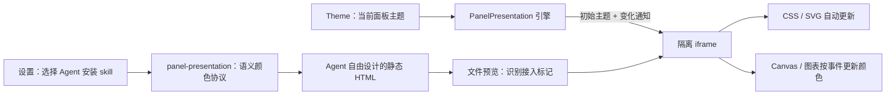

# 个人信息网页的主题适配架构

Agent 决定如何表达内容；面板在阅读时提供主题。生成物仍是自包含静态 HTML，同一个文件在主题切换后即时变色，不需要让 Agent 重新生成。

## 协议 v1

网页在 head 声明 `<meta name="tmux-panel-presentation" content="1">` 即表示愿意接收主题。
未声明的 HTML 按原样预览，不尝试猜测或替换其颜色。

引擎 `public/js/panel-presentation.js` 将现有 `--workspace-*` 和状态颜色映射为稳定的 `--pp-*` 语义变量；映射详见源码和 [skill](../skills/panel-presentation/SKILL.md)。这复用主题模块已有的对比度处理，不维护第二份调色板。引擎只设置变量、`color-scheme` 和 `data-panel-theme`，不注入布局、组件、字体、reset CSS 或动画。

文件预览载入时，将当前主题及一个接收桥放入 srcdoc 的首个脚本，在网页自身脚本运行前建立 `window.PanelPresentation.getTheme()`。CSS 声明和 SVG 直接引用变量；Canvas、WebGL 或第三方图表通过 `document` 上的 `panel-theme-change` 获取变化通知，事件 detail 为 `{version: 1, themeId, colorScheme, tokens}`。初次绘制应读取当前值；后续只更新需要重绘的颜色。

主题切换链路为 `Theme.apply()` → `tmux-theme-change` → 预览遍历当前 modal 和所有文件 Tab（包括脱离 DOM 的 Tab）→ `postMessage` → iframe 更新变量并发出 `panel-theme-change`。不重新赋值 srcdoc、不刷新 iframe。iframe load 后再发送一次最新主题，覆盖加载过程中发生的切换；重新挂回的 Tab 同样通过 load 接收当前主题。

原文件、源码视图不因接入而改写。导出、分享、新标签页使用导出时主题重新构建隔离快照。下载原文件保留原始内容；离开面板后由网页自己的 CSS fallback 保证可读，不能感知不存在的宿主主题。

## Skill 与设置

设置 → 管理中心 → 信息呈现网页，可以为单个 Agent 或全部受支持的 Agent 全局安装。当前沿用已有安装目标：`~/.codex/skills/panel-presentation`、`~/.claude/skills/panel-presentation`。目标为**面板所在机器的用户目录**；不在远程机器隐式安装。安装为指向本仓库的链接，更新项目即更新 skill；新 Agent 会话负责重新发现 skill。远程 Node 安装包与 macOS 客户端运行时都携带该 skill。

安装状态直接取自文件系统。逐个安装、移除和全部操作都只修改本项目拥有的链接；所有目标先检查冲突，再执行全部操作。文件系统异常仍可能导致部分完成，界面会重读实际状态并显示错误。同名个人 skill 始终不覆盖。未来若要支持其它 Agent，先确认其技能发现目录，再扩展受支持目标。

Skill 的作用限于选择合适的个人信息网页并接入配色。它不规定网页结构、字号、字体、布局、组件或依赖，也不要求每次回答都生成 HTML。数据语义色、品牌色和图片可以保留；用户指定视觉风格时可局部接入或完全退出。是否自动调用还受各 Agent 的 skill 发现与选择机制影响，安装不等于强制拦截其输出。

## 隔离与范围

预览继续使用 `sandbox="allow-scripts"`，不开放同源、父页数据、凭据、原生桥或顶层导航。宿主只发送版本号、主题 ID、深浅模式和限定的十六进制颜色；接收桥校验父窗口身份、宿主 origin、协议版本与颜色格式。发向 opaque-origin iframe 必须使用 `targetOrigin: '*'`，其中没有凭据。宿主不接受来自网页的指令或数据。

接入仅作用于面板的 HTML 文件预览，远程文件经已有 Node 文件 API 读取后同样适用。普通浏览器 block 中任意外部网站不属于此协议。引擎不承诺把已有的硬编码视觉作品自动重配色。

## 验证

自动测试覆盖：未接入网页保持原样、首屏与每种主题的变量映射、消息来源和输入校验、主题切换不改 srcdoc、隐藏 Tab 同步、源码和快照、全局安装与冲突保护。

[可选演示](../skills/panel-presentation/assets/example.html) 同时包含 CSS、SVG、Canvas、笔记输入和折叠区域，可在文件预览中验证换色与交互状态保留。
